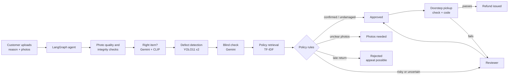

# ReturnGuard

**An agentic AI system that verifies clothing return requests from customer photos.**

A customer describes what is wrong with an order and uploads photos. An AI agent checks the photos and looks for damage
with trained defect detectors and an independent vision-language model. It then applies the store's return policy and
either approves the return, asks for better photos, or passes the case to a human reviewer with the evidence laid out.
Approved items are collected and checked at the customer's door before the refund is issued.

> Semester 7 project. The agent gathers evidence, and **deterministic policy rules make the final decision**. Language models
> can only make an outcome more cautious, never less. Anything uncertain goes to a person.

---

## Contents

1. [Features](#features)
2. [How it works](#how-it-works)
3. [Tech stack](#tech-stack)
4. [Getting started](#getting-started)
5. [Configuration](#configuration)
6. [Using the demo](#using-the-demo)
7. [Project structure](#project-structure)
8. [The agent and its tools](#the-agent-and-its-tools)
9. [Decision rules](#decision-rules)
10. [Defect detection model](#defect-detection-model)
11. [API reference](#api-reference)
12. [Testing](#testing)
13. [Security and privacy](#security-and-privacy)
14. [Limitations](#limitations)
15. [Further documentation](#further-documentation)
16. [Data and licences](#data-and-licences)

---

## Features

- **Three roles, one sign-in:** customers (`/account`), reviewers (`/admin`) and pickup partners (`/pickup`).
- **Photo quality gate:** blurry, dark, tiny or overexposed photos are caught on upload, and the customer gets a specific instruction.
- **Fraud and integrity checks:**
  - photos reused from another case (exact and near-duplicate hashing);
  - camera dates before delivery;
  - photos saved by editing software.
- **Right-item check:** Gemini compares each photo with the ordered product's type and colour. A CLIP comparison with catalog photos can confirm a match.
- **Trained defect detection:** two fine-tuned YOLO11 models find holes and stains and mark them with boxes. The models retry on zoomed tiles when unsure.
- **Independent second check:** Gemini looks at the marked area *without* being told the customer's claim. The comparison with the claim is done in code.
- **Policy retrieval (RAG):** the relevant clauses of the return policy are retrieved and cited in every decision.
- **Rule-based final decision:** an LLM proposes the outcome and writes the explanation; the policy engine decides.
- **Human-in-the-loop review:**
  - the queue is sorted by priority;
  - each case shows the evidence, the agent's step-by-step trace and the tool-call log;
  - every decision needs a reason code;
  - customers can appeal a decline.
- **Doorstep pickup:** a pickup partner checks the item against the order and the photos at the door. The customer confirms with a 4-digit code, and only then is the refund issued.
- **Guardrails:** each case is limited to 8 tool calls and 120 seconds. If the limits are hit, a tool fails, or an external API is down, the case goes safely to a reviewer.

## How it works



The agent decides which checks a case needs. For example:

- A late return skips the photo checks entirely, because the photos can't change the outcome.
- A photo of the wrong item skips damage detection.
- An unsure detection triggers a zoomed-in retry.
- Gemini is only consulted when its answer can change the outcome.

Every step appears live on the customer's page and is stored as an audit trail.

### Outcomes

| Decision | Customer sees | When |
|---|---|---|
| `AUTO_APPROVE` | Approved → Pickup scheduled → Refunded | A defect is confirmed by both the detector and Gemini (refund or replacement), or an undamaged change-of-mind return (store credit). The order is ₹5,000 or less. |
| `REQUEST_MORE_EVIDENCE` | Photos needed | Unusable photos, no garment visible, wrong item, or the claimed damage isn't visible. At most two requests. |
| `AUTO_REJECT` | Rejected | Only for returns outside the 10-day window. The customer can appeal. |
| `ESCALATE_TO_HUMAN` | With reviewer | Everything uncertain or risky: checks disagree, integrity flags, high value, non-returnable items, tool failures. |

## Tech stack

| Layer | Technology |
|---|---|
| Web server and API | FastAPI, Uvicorn, Pydantic |
| Agent orchestration | LangGraph |
| Storage | SQLite (single file, auto-migrating) |
| Computer vision | Ultralytics YOLO11 (fine-tuned), OpenCV, CLIP (Hugging Face Transformers) |
| Vision-language model | Google Gemini via its OpenAI-compatible API (`gemini-3.5-flash-lite`, fallback `gemini-2.5-flash`) |
| Text LLM | Any OpenAI-compatible endpoint (we use Groq `openai/gpt-oss-120b`) or Anthropic; optional |
| Policy retrieval | scikit-learn TF-IDF + cosine similarity |
| Frontend | Plain HTML, CSS and JavaScript (no build step), responsive for phone and desktop |
| Tests | pytest |

## Getting started

### Prerequisites

- Python 3.12 (3.10 or newer should work)
- About 2 GB of disk space for PyTorch and the models
- Optional: an NVIDIA GPU. Everything runs on CPU, but more slowly.
- Optional but recommended: a free [Gemini API key](https://aistudio.google.com/apikey) and a free [Groq API key](https://console.groq.com/keys)

### Installation

```bash
git clone <repository-url>
cd returnguard

python -m venv .venv
.venv\Scripts\activate            # Windows
# source .venv/bin/activate       # macOS / Linux

pip install -r requirements.txt
pip install ultralytics           # the trained clothing-defect models (pulls in PyTorch)
```

The trained weights are included in the repository at `CV/runs/deploy/` (about 60 MB), so no training is needed to run the app.

**Optional: catalog similarity (CLIP).** The product check can also compare uploads with catalog photos. It needs `transformers`,
which is kept outside the main virtual environment:

```bash
pip install --target CV/.pydeps transformers
```

If you skip this, the product check uses Gemini alone, and the app logs that the catalog comparison was skipped.

### Configure

```bash
copy .env.example .env            # Windows
# cp .env.example .env            # macOS / Linux
```

Then fill in the keys (see [Configuration](#configuration)). Keys stay on the server and are never sent to the browser.
Don't commit `.env`: it is already in `.gitignore`.

### Run

```bash
uvicorn app.main:app --reload
```

Open <http://localhost:8000>. The database (`data/returnguard.db`) and demo accounts are created on first start.

To check which components are active, open <http://localhost:8000/api/health>. It reports:

- the vision backend;
- the LLM provider;
- whether Gemini is set up;
- whether face blurring is available.

**Open it on a phone on the same Wi-Fi** with `uvicorn app.main:app --host 0.0.0.0 --port 8000`, then browse to `http://<laptop-ip>:8000`.

## Configuration

All settings live in `app/config.py` and can be overridden in `.env`. The most useful ones:

| Variable | Default | Purpose |
|---|---|---|
| `GEMINI_API_KEY` | *(empty)* | Enables the right-item check and the blind damage check. Without it, defect claims go to a reviewer instead of being auto-approved. |
| `VLM_MODEL` / `VLM_FALLBACK_MODEL` | `gemini-3.5-flash-lite` / `gemini-2.5-flash` | Primary Gemini model, and the model tried once when the primary is overloaded or times out. |
| `LLM_PROVIDER` | `auto` | `openai` (any OpenAI-compatible API), `anthropic`, or `rules` (no LLM). `auto` picks from the keys present. |
| `OPENAI_BASE_URL`, `OPENAI_API_KEY`, `OPENAI_MODEL` | — | For Groq: `https://api.groq.com/openai/v1`, model `openai/gpt-oss-120b`. Ollama and others also work. |
| `ANTHROPIC_API_KEY`, `LLM_MODEL` | — | Use Claude as the text LLM instead. |
| `RETURN_WINDOW_DAYS` | `10` | Return window (policy R1). |
| `AUTO_APPROVE_MAX_PRICE` | `5000` | Orders above this (₹) always need a reviewer (R7). |
| `AUTO_REJECT_OUTSIDE_WINDOW` | `1` | Set to `0` to send late returns to a reviewer instead of declining them. |
| `MAX_EVIDENCE_ROUNDS` | `2` | How many times a customer can be asked for new photos. |
| `MAX_TOOL_CALLS`, `CASE_TIME_LIMIT_S` | `8`, `120` | Agent guardrails per case. |
| `REQUIRE_VLM_FOR_APPROVAL` | `1` | Auto-approve a defect only when Gemini confirms it. |
| `CLOTHES_DEVICE` | `auto` | `cpu`, or `0` for the first GPU. |
| `CLOTHES_SECOND_OPINION` | `0` | Adds Grounding DINO as a third detector (slow on CPU, needs `CV/.pydeps`). |
| `SHOW_DEMO_ACCOUNTS` | `1` | Shows test accounts and the reset button on the login page. **Set to `0` for any public deployment.** |
| `RG_DATA_DIR` | `data/` | Where the database and uploaded photos are stored. |

Without any keys the app still works end to end: claims are parsed with keywords, the rules decide alone, and cases that
need a second opinion go to a reviewer.

## Using the demo

Sign in at `/login`. The **Test account** dropdown fills in the form. The **↻** button next to it resets the demo: it
deletes every return, photo and pickup, and case numbers restart at RG-000001.

| Role | Username | Password | Notes |
|---|---|---|---|
| Customer | `asha` | `demo1234` | ORD-3001 crop sweater (white), ORD-3002 ribbed knit tee (army green) |
| Customer | `ravi` | `demo1234` | ORD-3003 cable knit sweater set, ORD-3004 striped pyjama set |
| Customer | `neha` | `demo1234` | ORD-3005 quilted tights (navy), ORD-3006 thermal knit set |
| Reviewer | `reviewer` | `review1234` | Sees every case in the queue at `/admin` |
| Pickup partner | `courier` | `pickup1234` | Collects approved returns at `/pickup` |

The demo orders are real Amazon Fashion products. `demo_amazon/` contains their catalog photos and a matching damaged-item
photo for each order. `demo_amazon/README.md` says which photo to upload for which order.

### Suggested walkthrough

1. **As `asha`:** start a return for ORD-3001 and upload `demo_amazon/customer_photos/ORD-3001_asha_upload.jpg` with a reason such as "it arrived with a hole in the sleeve". Watch the agent's steps appear.
2. **Try a wrong item:** for ORD-3002, upload a photo of a different item, such as a bag. The agent asks for a photo of the ordered tee.
3. **As `reviewer`:** open the queue, inspect an escalated case (photos with boxes, trace, cited clauses) and decide with a reason code.
4. **As `courier`:** open the pickup for an approved return, tick the three checks and enter the code shown on the customer's return page. The customer's status changes to *Refunded*.

## Project structure

```
returnguard/
├── app/                      # Backend (FastAPI + agent)
│   ├── main.py               # Page routes, REST API, uploads, access control
│   ├── agent.py              # LangGraph workflow, routing, guardrails, run_case()
│   ├── tools.py              # Agent tools T0–T10 (also served over MCP)
│   ├── mcp_server.py         # MCP server exposing the tools: python -m app.mcp_server
│   ├── decision.py           # Policy rules, reason codes, LLM/rules merge
│   ├── preanalysis.py        # Quality gate, duplicate hashing, EXIF, face blurring
│   ├── vision.py             # Defect detection (wraps CV/scripts/predict.py), zoom tiles
│   ├── product.py            # Right-item check (Gemini + CLIP catalog similarity)
│   ├── vlm.py                # Gemini blind damage check; shared call with retry/fallback
│   ├── llm.py                # Claim parsing and decision proposal (optional LLM)
│   ├── policy.py             # Policy clause retrieval (TF-IDF)
│   ├── pickup.py             # Doorstep pickup: schedule, complete, fail
│   ├── db.py                 # SQLite schema, migrations, demo seed data
│   ├── auth.py, security.py  # Sessions, role checks, password hashing
│   └── config.py             # All settings (overridable from .env)
├── agentic/schemas.py        # Pydantic schemas for LLM output
├── static/                   # Frontend: login, customer, review, pickup, policy pages
├── policy/return_policy.md   # The return policy (clauses R1–R9)
├── CV/                       # Model training and evaluation
│   ├── scripts/              # prepare, train, evaluate, predict
│   ├── runs/deploy/          # The two deployed model weights (used by the app)
│   └── defect_check.ipynb    # Notebook to try the models on your own photos
├── weights/                  # YuNet face detector (for blurring)
├── demo_amazon/              # Demo catalog and customer photos (see licences)
├── tests/                    # pytest suite
├── docs/                     # Study guide (PDF) with diagrams
└── data/                     # Runtime: database and uploads (created automatically)
```

## The agent and its tools

The agent is a LangGraph state graph in `app/agent.py`. Each node calls one tool, and the routing functions choose the next
node from the evidence so far.

| Step | Tool | What it does |
|---|---|---|
| `get_order` | T0 `lookup_order` | Finds the order; computes days since delivery and whether the return window is still open. |
| `parse_claim` | `parse_claim` | LLM turns the customer's text into `{defect_type, location, timing, requested_resolution}`, validated by a Pydantic schema; keyword fallback. |
| `check_photos` | T1 + T7 `assess_photos` | Quality gate (size, sharpness, brightness) and integrity checks (duplicates, EXIF). |
| `verify_product` | T3 `verify_product` | Is the ordered item in the photos? Gemini yes/no/unclear per photo + CLIP catalog similarity. |
| `detect_defects` | T4 `detect_defects` | Two YOLO11 models on every usable photo; the most damaged photo becomes the evidence. |
| `zoom_in` | T4 (tiles) | Same models on four overlapping zoomed crops, used when the first result is weak. |
| `verify_with_vlm` | T9 `verify_with_vlm` | Gemini describes the marked crop without seeing the claim. |
| `retrieve_policy` | T8 `retrieve_policy` | Top-3 relevant policy clauses (R1 always included). |
| `decide` | — | LLM proposal merged with the policy rules (see below). |
| `finalize` | T10 `create_ticket` | Files a ticket in the right queue. |

Every tool call is logged with its arguments, result, latency and any error (`tool_calls` table), and is shown to reviewers.

## Decision rules

The policy is in `policy/return_policy.md` (R1–R9) and is implemented as code in `app/decision.py`. The rules are evaluated
in order, and the first match wins:

1. Order not found → reviewer (R7)
2. Delivered more than 10 days ago → declined automatically; the customer can appeal (R1)
3. Non-returnable type (innerwear, swimwear, socks, customised) → reviewer (R4)
4. Photo integrity flag → reviewer (R8)
5. No usable photo, or no garment visible → ask for photos, then reviewer (R5)
6. Photos show a different item → ask for photos, then reviewer (R5)
7. **Defect claimed:**
   - detector and Gemini agree, and the order is ₹5,000 or less → **approve refund/replacement** (R2);
   - the two checks disagree, the damage is a different kind than claimed, or the order is high value → reviewer (R6/R7);
   - damage isn't visible → ask for a close-up, then reviewer.
8. **No defect claimed** (change of mind):
   - clean garment, ₹5,000 or less → **approve store credit** (R3);
   - any visible damage → reviewer (R6).

**Identity gate:** an approval also requires at least one photo to show the ordered item.
**LLM merge:**

- If the LLM agrees with the rules, its wording is used, and citations to clauses that don't exist are removed.
- If it disagrees with an approval, the case is escalated.
- Otherwise the rules' outcome stands.

## Defect detection model

The app uses a **two-model predictor** (`CV/scripts/predict.py`), loaded by `app/vision.py`:

- **Detector:** YOLO11s, fine-tuned. Answers "is it damaged?" and rarely flags clean garments.
- **Locator:** YOLO11m, fine-tuned. Answers "where is the damage?" and finds more holes and stains.
- **Vote:**
  - *damaged* if detector ≥ 0.20 or locator ≥ 0.40;
  - *unsure* if detector ≥ 0.15 or locator ≥ 0.25;
  - *clean* otherwise.
- **Large photos:** on photos over 1000 px, both models also run on a crop of the garment, so small holes survive the resize.

**Data:**

- Roboflow *defect-clothes-v2* (CC BY 4.0): 289 unique source photos with classes clothes, hole and stain.
- It is split **by source photo** (203 / 43 / 43), so augmented copies never leak into validation or test.
- The training set is extended with *defect-clothes-ukrks*, added to train only.

**Results:**

| Evaluation | Accuracy | Precision | Recall | Specificity |
|---|---:|---:|---:|---:|
| Held-out test split (43 photos, scored once) | 90.7 % | 90.0 % | 96.4 % | 80.0 % |
| Real-world Amazon review photos (199) | 81.9 % | 73.7 % | 51.9 % | 93.1 % |

On box mAP@50 for defects on the validation set, the detector scores 0.323 and the locator 0.362.

Real customer photos are harder than the dataset: the models catch about half the real-world damage. That is why the
system never approves on the detector alone. See [Limitations](#limitations).

**Retraining** (run from the repository root with `ultralytics` installed). Each script's docstring lists its options.

```bash
python CV/scripts/prepare.py                 # split the raw Roboflow export by source photo
python CV/scripts/prepare_merged.py --extra <extra-roboflow-export>
python CV/scripts/train.py --model yolo11s.pt --name <run-name>
python CV/scripts/evaluate.py --weights CV/runs/<run-name>/weights/best.pt
python CV/scripts/evaluate_predictor.py      # photo-level verdicts of the two-model predictor
python CV/scripts/predict.py path/to/photo.jpg
```

Datasets are not in the repository (`CV/datasets/` is gitignored). Download them from Roboflow Universe into `CV/datasets/<name>/raw/`.
To deploy new weights, copy them to `CV/runs/deploy/clothes_damage_detector.pt` and `clothes_damage_locator.pt`, or
point `CLOTHES_DETECTOR` / `CLOTHES_LOCATOR` at them.

## API reference

Every endpoint except login, health, config, policy and the demo reset needs a session cookie. Role checks are enforced server-side.

| Method | Endpoint | Role | Purpose |
|---|---|---|---|
| `POST` | `/api/login`, `/api/logout` | any | Sign in / out (HTTP-only session cookie) |
| `GET` | `/api/me`, `/api/health`, `/api/config`, `/api/policy` | any | Current user, component status, UI config, policy clauses |
| `GET` | `/api/orders` | customer | The customer's orders with their return status |
| `POST` | `/api/precheck` | customer | Quality check of one photo before submitting |
| `POST` | `/api/cases` | customer | New return (multipart form: `order_id`, `reason`, `images`) |
| `GET` | `/api/cases`, `/api/cases/{id}` | customer / reviewer | List own returns; case detail (reviewers get the full evidence) |
| `POST` | `/api/cases/{id}/evidence` | customer | Add photos when asked |
| `POST` | `/api/cases/{id}/appeal` | customer | Appeal a declined return |
| `GET` | `/api/review/queue?filter=` | reviewer | Prioritised queue (`all`, `escalated`, `photos`, `flagged`, `decided`) |
| `POST` | `/api/cases/{id}/review` | reviewer | `approve` / `reject` / `request_info` with a reason code |
| `GET` | `/api/pickups`, `/api/pickups/{id}` | courier | Assigned pickups; full job with checklist and photos |
| `POST` | `/api/pickups/{id}/complete` | courier | Confirm with the checks, customer code and an optional photo → refund |
| `POST` | `/api/pickups/{id}/fail` | courier | `not_home` (rescheduled) or a failed check (back to a reviewer) |
| `POST` | `/api/demo/reset` | public | Reset demo data; only when `SHOW_DEMO_ACCOUNTS=1` |

FastAPI also serves interactive docs at <http://localhost:8000/docs>.

## Testing

```bash
python -m pytest -q
```

The suite has 36 tests in `tests/`. It runs offline against a temporary database with synthetic photos
(`scripts/make_synthetic_data.py`) and the agent running inline. It covers:

- every policy rule and the LLM-merge safeguards;
- the quality gate and claim parsing;
- sign-in and per-role access control (including private photos);
- end-to-end return flows: approval, photo requests, wrong item, reused photo, late return and appeal;
- the reviewer flow;
- doorstep pickup (refund and failed check);
- Gemini outage handling;
- the demo reset.

## Security and privacy

- **Passwords:** hashed with PBKDF2-SHA256 (200,000 iterations, per-user salt).
- **Sessions:** random tokens in HTTP-only, SameSite cookies.
- **Access control:** customers only see their own orders, cases and photos. Pickup partners only see photos for pickups assigned to them. Requests for anything else return 404.
- **Uploads:**
  - size, type and count limits;
  - each file is decoded and re-encoded with a random file name;
  - re-encoding strips all metadata, including GPS location, after the integrity checks have read it.
- **Faces:** blurred (OpenCV YuNet) before any image is sent to Gemini.
- **LLM output:** customer text is treated as data, never as instructions. LLM output is schema-validated and cannot override the rules.
- **Integrity flags:** worded as neutral observations, not accusations. Only humans decline returns, apart from late ones, and every decline can be appealed.
- **Keys:** stay in `.env` or the hosting platform's secrets.

## Limitations

- **Real-world accuracy:** the defect models were trained on a small public dataset. On real customer photos they find about half of the visible damage. They struggle most with:
  - close-ups that show no whole garment;
  - busy prints;
  - large tears and seams.

  The system compensates with zoom-in, Gemini, photo requests and human review, but more real, labelled photos are the main way to improve.
- **Gemini dependence:** when Gemini is unavailable, defect claims can't be auto-approved and go to a reviewer. The free tier has daily request limits.
- **Categories:** clothing only (holes and stains). Other defect types and product categories would need new data and models.
- **Demo scope:**
  - SQLite and local file storage, so there is a single server instance;
  - refunds are recorded but not connected to a payment system;
  - pickups are assigned to the single courier account.
- **`scripts/evaluate.py` and `reports/eval_report.md`** come from an early prototype that used synthetic photos and a classical CV baseline. They don't reflect the current models. Use the CV results above instead.

## Further documentation

- **[docs/ReturnGuard_Study_Guide.pdf](docs/ReturnGuard_Study_Guide.pdf):** a 23-page guide to the whole system. It includes architecture, sequence, state-machine and agent diagrams, the rule ladder, the CV pipeline, the database schema, a glossary and likely viva questions. Rebuild it with `python docs/make_guide.py`, then print the HTML to PDF.
- `policy/return_policy.md`: the full return policy.
- `demo_amazon/README.md`: which demo photo belongs to which order.
- Docstrings at the top of each module in `app/` and `CV/scripts/` explain the design decisions in detail.

## Data and licences

- **Training data:** Roboflow Universe *defect-clothes-v2* and *defect-clothes-ukrks* (CC BY 4.0).
- **Demo photos (`demo_amazon/`):** from the Amazon Reviews 2023 dataset (McAuley Lab), which is licensed for **research use only**. Don't use them commercially or publish them outside this academic project.
- **Face detector:** OpenCV YuNet (`weights/face_detection_yunet_2023mar.onnx`), MIT licence.
- **Base models:** Ultralytics YOLO11 (AGPL-3.0) and OpenAI CLIP (MIT).
